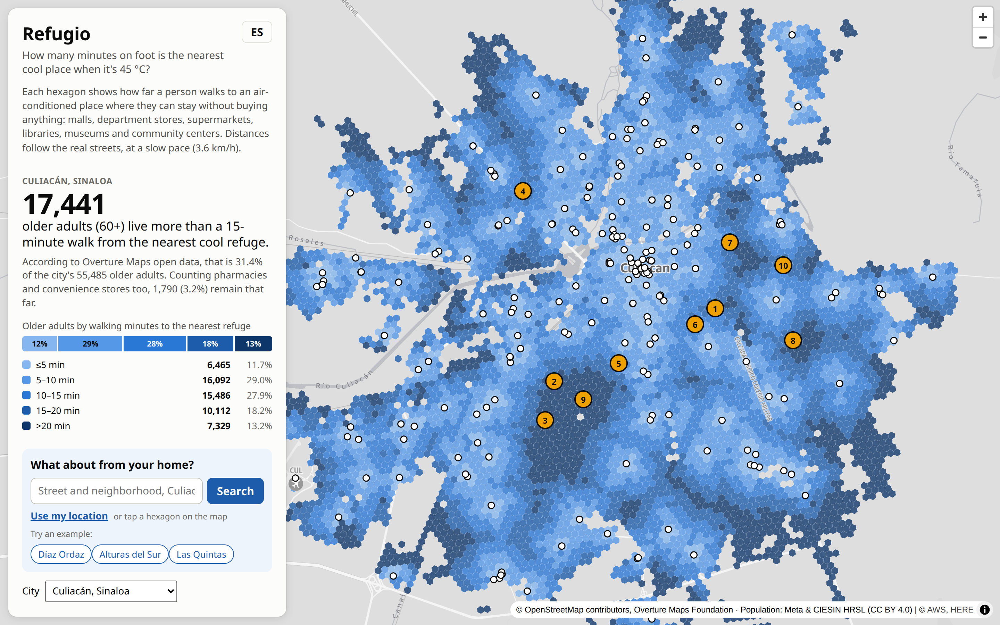
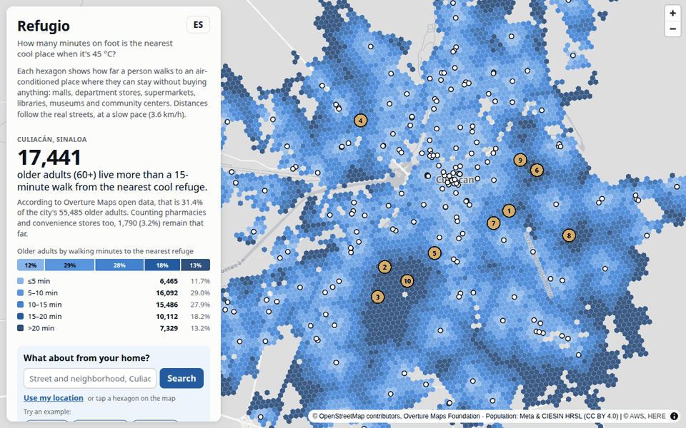
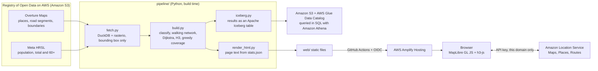
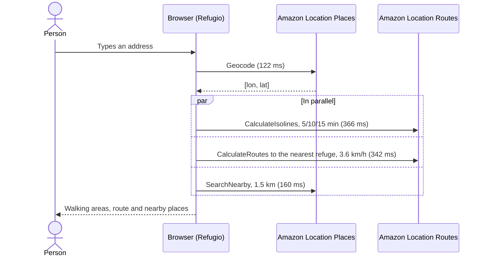
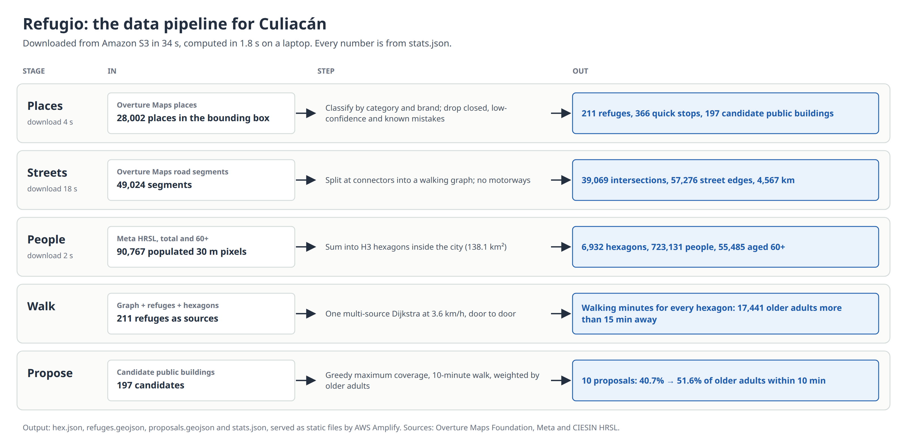
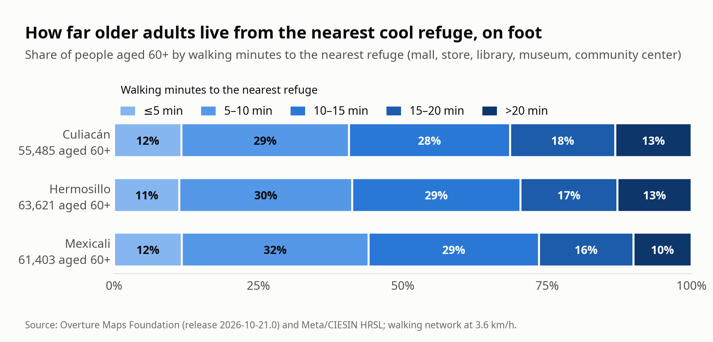
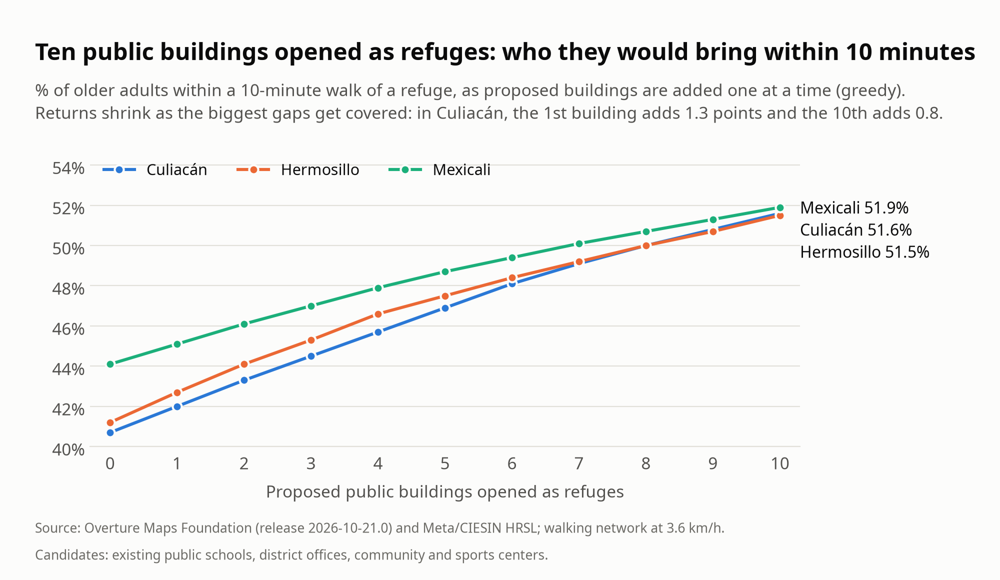

# Refugio - how far is the nearest cool place, on foot, in 45 °C heat?

A walking-time map of cool refuges for older adults in Culiacán, Hermosillo and Mexicali (Mexico), built from
open data on AWS and Amazon Location Service. Made for the AWS Builder Center **Weekend Challenge: Map it**
(Oct 31 - Nov 2, 2026).



## Try it in 1 minute

- **Live map:** https://main.d6r3007drgrwp.amplifyapp.com (Spanish by default; press **EN** for English)
- Press one of the three example buttons, or type any Culiacán address, e.g. `Colonia Libertad, Culiacán`.
  Tap any hexagon, switch to "refuges + pharmacies and stores", or change the city to Hermosillo or Mexicali.
- **Method, results and validation on one page:** https://main.d6r3007drgrwp.amplifyapp.com/about.html

## Why

Culiacán reaches 45 °C, and Sinaloa ranked first in Mexico for heat-related illness cases in week 32 of 2026.
An older adult without a car walks to wherever they can cool down, and a radius on a map says nothing about
how far that is on foot. Refugio measures the walk along the streets and counts who lives at each distance.

**In Culiacán, 17,441 older adults (60+), 31.4% of the 55,485 who live in the city, are more than a 15-minute
walk from the nearest air-conditioned place where they can stay without buying anything** (Overture Maps open
data). Across the three cities, 52,542 are.

## What it does

- **Planning layer** (precomputed, 100% open data): walking minutes from every H3 hexagon to the nearest refuge
  (mall, department store, large supermarket, library, museum, cultural or community center), where older
  adults live, the areas where refuges are missing, and 10 existing public buildings that would bring the most
  older adults within 10 minutes (Culiacán: from 40.7% to 51.4%).
- **Personal layer** (live, Amazon Location Service): from an address, a tap or your location, the area you can
  reach on foot in 5, 10 and 15 minutes, the walking route to the nearest refuge, and cool places nearby.



## How it works




One search, measured on the live site (median of 5 searches, 486 ms in total):



**Design principle: open data finds the gaps; Amazon Location guides the person.** The citywide layer comes only
from open data, so anyone can recompute it. Amazon Location results are used once (`SingleUse`) and never stored.



| Service | Used for |
|---|---|
| Registry of Open Data on AWS (Amazon S3) | Overture Maps and Meta HRSL, read by bounding box |
| Amazon Location Service: Maps | Base map |
| Amazon Location Service: Places | Geocode and SearchNearby |
| Amazon Location Service: Routes | CalculateIsolines and CalculateRoutes (pedestrian) |
| AWS Amplify Hosting | Static site, CDN and HTTPS |
| AWS Budgets | Cost alerts |
| Amazon S3, AWS Glue and Amazon Athena | The results as an Apache Iceberg table (one snapshot per city), queried in SQL |

## Evidence

| Check | Result |
|---|---|
| Open-data walking minutes vs Amazon Location `CalculateRoutes`, 50 random hexagons | Median difference 0.5 min; 94% within ±2 min; correlation 0.99 |
| Places Overture is missing | Amazon Location knows a refuge-type place clearly closer in 10% of those hexagons, so the share far from a refuge is probably somewhat lower |
| Spot-check of 15 random refuges | 10 found by name within 300 m, 8 with a compatible category |
| Street network realism | Walking along streets is a median 1.24 times the straight line in Culiacán |
| Older adults: HRSL vs INEGI 2020 census | HRSL: 7.7% of Culiacán is 60+; census: 10.9%. Counts are probably low; shares hold if the gap is even ([pipeline/census.py](pipeline/census.py)) |

Details: [docs/validation.md](docs/validation.md). The results as an Apache Iceberg table, with example SQL
queries, a snapshot per city and time travel: [docs/iceberg.md](docs/iceberg.md). Development journal, with every decision and mistake:
[docs/journal.md](docs/journal.md).





## Reproduce it

### The data (no AWS account needed)

```bash
python3 -m venv .venv && source .venv/bin/activate
pip install -r pipeline/requirements-dev.txt
python pipeline/fetch.py culiacan      # ~35 s: reads only the city's bounding box from Amazon S3
python pipeline/build.py culiacan      # ~2 s: writes web/data/culiacan/
python pipeline/census.py              # compares the 60+ share with INEGI's 2020 census
python pipeline/render_html.py         # writes the page text, about.html and llms.txt from stats.json
pytest pipeline/tests                  # 47 tests
```

Cities are configured in `pipeline/cities.py` (`hermosillo` and `mexicali` work the same way).

### The web app

```bash
python3 -m http.server -d web 8000     # then open http://localhost:8000
```

Without `web/config.js` the app runs in demo mode (precomputed data and a straight line instead of a route). For
live searches, create `web/config.js` (it is git-ignored) with an Amazon Location API key that allows `localhost`:

```javascript
window.REFUGIO_CONFIG = { region: 'us-west-2', apiKey: '<your key>' };
```

### Evidence, diagrams and screenshots

```bash
pip install -r pipeline/requirements-evidence.txt playwright && playwright install chromium
AWS_PROFILE=<profile> python pipeline/evidence.py culiacan   # validation against Amazon Location (~115 requests)
python docs/diagrams/charts.py                               # K6, K7
python docs/diagrams/capture.py                              # screenshots, GIF, latency (live site, ~50 requests)
python docs/diagrams/render.py                               # K1-K3 (downloads the official AWS icons once)
```

### Infrastructure and deployment

- `infra/`: Terraform for the Amazon Location API keys (restricted to 5 actions and to the site's domain, expiring
  2027-01-31), the Amplify app, a $5 monthly budget with email alerts, and the IAM role GitHub Actions assumes
  through OIDC. Copy `terraform.tfvars.example` to `terraform.tfvars`, then `terraform -chdir=infra init && terraform -chdir=infra apply`.
- `infra/analytics.tf`: the results as an Apache Iceberg table on Amazon S3: a private bucket, a Glue database
  and an Athena workgroup that cancels queries over 1 GB, with query results deleted after 7 days. After
  `apply`, fill it with `python pipeline/iceberg.py --bucket "$(terraform -chdir=infra output -raw analytics_bucket)"`
  (needs `requirements-evidence.txt` and AWS credentials; about 26 s and under one cent of Athena queries).
- `.github/workflows/ci.yml`: tests, a secret scan (gitleaks) and Terraform checks on every pull request.
- `.github/workflows/deploy.yml`: on every push to `main`, the same checks, then `deploy/deploy.sh` publishes `web/`
  to Amplify and a smoke test checks the live site.
- `.github/workflows/uptime.yml`: checks the live site every 3 hours.

## Repository layout

| Path | What it is |
|---|---|
| `pipeline/` | `fetch.py` (download), `build.py` (walking access), `render_html.py` (page text), `evidence.py` (validation), `iceberg.py` (Iceberg table), tests |
| `web/` | The static app (`index.html`, `app.js`, `style.css`), `about.html`, `llms.txt`, and `web/data/` with the generated data |
| `docs/` | Development journal, validation results, and the scripts and images of the diagrams, charts and screenshots |
| `infra/` | Terraform |
| `deploy/` | The deploy script used by GitHub Actions |

## Limitations

Air conditioning and free entry are assumed from the type of place; Overture doesn't list every place; HRSL
counts about 30% fewer people aged 60+ than the 2020 census; shade, sidewalks, safety and opening hours aren't modeled; the walking
speed (3.6 km/h) is an assumption, and Amazon Location isolines use the service's default pedestrian speed.

## Data sources and licenses

- [Overture Maps Foundation](https://docs.overturemaps.org/attribution/), release 2026-10-21.0: transportation and
  divisions (ODbL, © OpenStreetMap contributors); places (Meta and Microsoft, CDLA Permissive 2.0; Foursquare,
  Apache 2.0; AllThePlaces, CC0).
- [Meta and CIESIN – Columbia University, High Resolution Settlement Layer](https://registry.opendata.aws/dataforgood-fb-hrsl/) (CC BY 4.0).
- Base map and live search: Amazon Location Service.
- Diagrams use the official AWS Architecture Icons, which are not covered by this repository's license.

Code: [MIT](LICENSE). Data in `web/data/`: ODbL 1.0, with the attributions in [DATA_LICENSE.md](DATA_LICENSE.md).

## How AI was used

Planning, research and the pipeline prototype with Claude; implementation with Claude Code. I reviewed and can
explain every piece.
