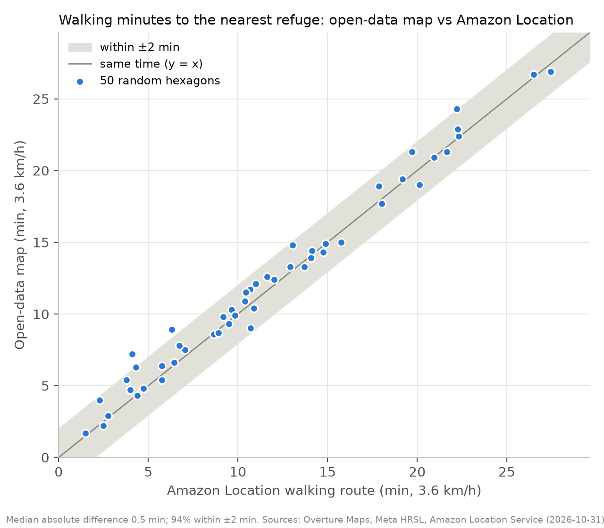

# Validation against Amazon Location Service

Generated by `pipeline/evidence.py`. Only these aggregate numbers are kept: the Amazon Location
responses were used once and not stored (IntendedUse "SingleUse").

<!-- BEGIN:routes -->
## 1. Walking minutes: open-data map vs Amazon Location routes

50 random hexagons with at least 5 older adults (random seed 2026, run on 2026-10-31).
For each one, Amazon Location `CalculateRoutes` (Pedestrian, 3.6 km/h) from the hexagon center to the refuge our map says is nearest.

| Metric | Value |
|---|---|
| Median absolute difference | 0.5 min |
| 90th percentile of the absolute difference | 1.7 min |
| Within ±2 min | 94% |
| Within ±5 min | 100% |
| Median difference (open data minus Amazon) | +0.2 min |
| Correlation | 0.99 |

A positive median difference means the open-data map is conservative: it measures to the nearest
street corner and then straight to the door, while Amazon Location routes to the address itself.

## 2. Coverage gap: places Overture is missing

For the same hexagons, Amazon Location `SearchNearby` for refuge-type places (malls, department
stores, libraries, museums, community centers) at least 150 m closer, in a straight line,
than our nearest refuge.

| Metric | Value |
|---|---|
| Hexagons where Amazon Location knows a refuge-type place clearly closer | 10% |
| Share of the sampled older adults living in those hexagons | 12% |

So the headline figure (older adults more than 15 minutes from a refuge, from open data) is best
read as an upper bound. Amazon's categories don't say whether a place is air-conditioned or lets
people stay, so not every one of those places is a real refuge either.

Billable requests for checks 1 and 2: 100.
<!-- END:routes -->

<!-- BEGIN:spot -->
## 3. Spot-check of 15 random refuges

Random seed 2027, run on 2026-10-31. For each refuge, Amazon Location `SearchText` for its
name near its location: is there a place with a similar name within 300 m, and does its category
agree with the type we assumed?

| Result | Count |
|---|---|
| Found by Amazon Location within 300 m | **10 of 15** |
| ...and with a compatible category | **8 of 15** |

| Refuge (Overture) | Our type | Found | Category agrees |
|---|---|---|---|
| Ley Abastos | super | yes | yes |
| Super Ley Express Valle Alto | super | yes | yes |
| Ley plaza Pabelón | super | yes | yes |
| Sinaloa INAH Center | museo | yes | yes |
| MASIN Museo de Arte de Sinaloa | museo | yes | yes |
| Coppel | departamental | yes | yes |
| Explanada Culiacán | plaza | yes | yes |
| Megacable Universitarios | plaza | no | no |
| Soriana | super | no | no |
| Plaza Forum | plaza | no | no |
| Eco Plaza Perisur | plaza | no | no |
| Sears | departamental | yes | no |
| Soriana Híper Zapata | super | yes | yes |
| Plaza Ley | super | no | no |
| Centro Joyero | plaza | yes | no |

Billable requests for check 3: 15.
<!-- END:spot -->

## Notes from the manual review

- A "no" in the spot-check doesn't prove a place is missing: chain names (Soriana) and different
  commercial names ("Plaza Forum" vs "Forum Culiacán") are hard to match automatically.
- Clear false positives found while reviewing every refuge name by hand: a cable company office and a
  travel agency labeled as malls, a temazcal (steam bath) and a municipal records office labeled as
  community centers, a religious group and a private language school labeled as cultural centers.
  They are excluded in `pipeline/build.py` (`NOT_REFUGES`), with tests.
- Checks 1 and 2 ran before that cleanup (217 refuges, now 211). They will be re-run on the final data.
