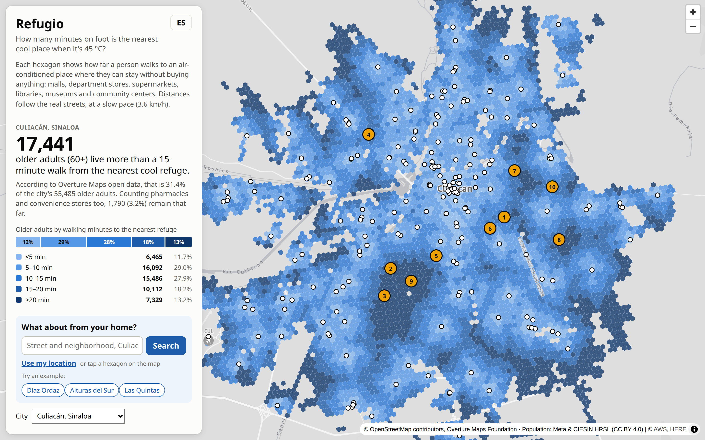
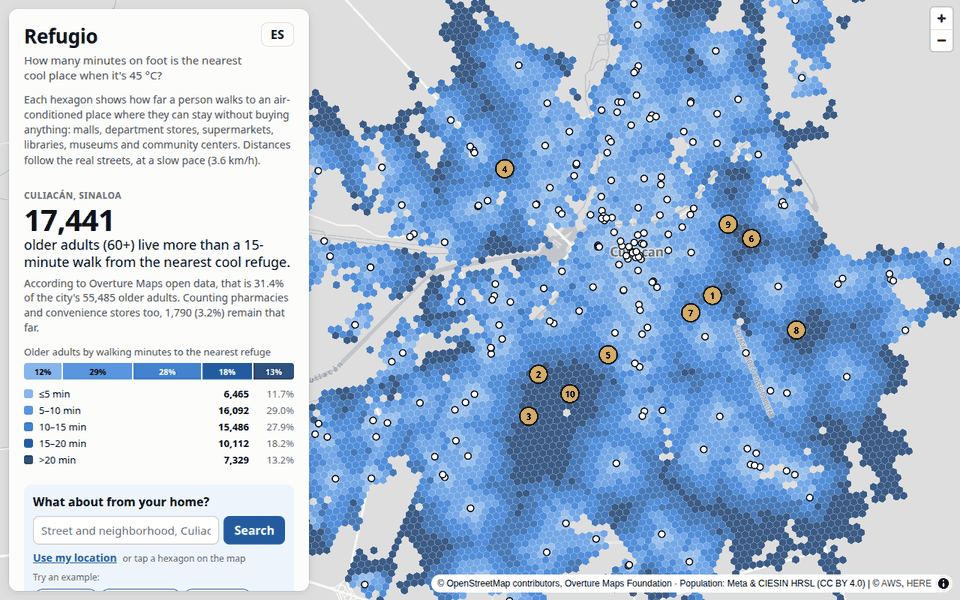
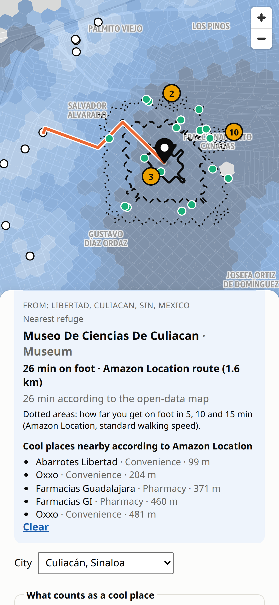
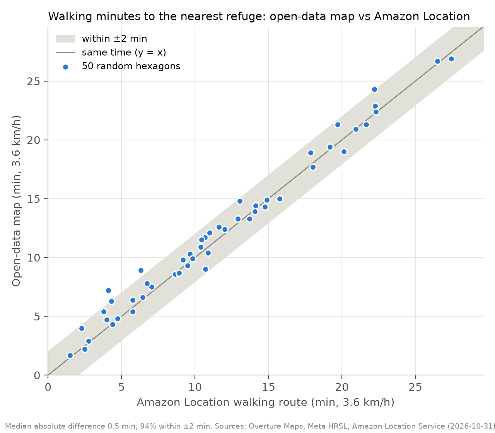
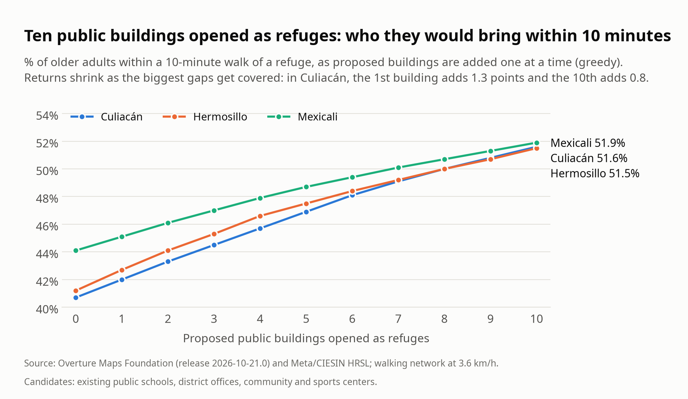
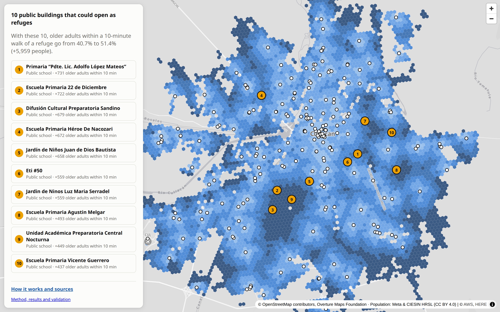

<!--
TRADUCCIÓN para que José revise el artículo en español. NO es la versión que se publica:
en Builder Center se publica docs/writeup.md (en inglés). Si cambias algo aquí, avísale a Claude
para pasarlo al inglés (o cámbialo tú en los dos archivos).
-->

# Refugio: ¿cuánto tienen que caminar los adultos mayores de Culiacán, con 45 °C, para llegar a un lugar fresco?

> **Pruébalo en 1 minuto**
>
> - **Mapa en vivo:** https://main.d6r3007drgrwp.amplifyapp.com (en español por defecto; el botón **EN** lo cambia a inglés)
> - Presiona uno de los tres botones de ejemplo (**Díaz Ordaz**, **Alturas del Sur**, **Las Quintas**) o escribe
>   cualquier dirección de Culiacán, por ejemplo `Colonia Libertad, Culiacán`. También puedes tocar cualquier hexágono.
> - Cambia la ciudad a **Hermosillo** o **Mexicali**, y prueba la opción "refugios + farmacias y tiendas".
> - **Método, resultados y validación en una sola página:** https://main.d6r3007drgrwp.amplifyapp.com/about.html
> - **Código (MIT) y datos (ODbL):** https://github.com/Josegas/Refugio-mapa-de-refugios-contra-el-calor
> - **Video (menos de 3 min):** TODO(José): link de YouTube

## 1. El problema

*Un ejemplo ficticio, construido con datos reales.* Carmen tiene 72 años y vive en la colonia Libertad, al
suroeste de Culiacán. Una tarde de julio, a 44 °C, quiere sentarse en algún lugar con aire acondicionado sin
tener que comprar nada. Según los datos abiertos, el lugar así más cercano es el museo de ciencias de la ciudad:
a 1.6 km, **26 minutos a pie** al paso de una persona mayor. La ruta a pie de Amazon Location da los mismos 26 minutos.

Su colonia no es la excepción:

- Sinaloa fue el primer lugar nacional en casos de enfermedades por calor en la semana epidemiológica 32 de 2026
  (20 casos, según la Secretaría de Salud) ([fuente](https://www.yucatan.com.mx/merida/2026/08/20/otro-caso-de-golpe-de-calor-en-yucatan-en-mexico-hay-4-nuevas-defunciones.html)).
- México registró al menos 121 muertes por temperaturas extremas entre marzo y agosto de 2026
  ([fuente](https://www.unotv.com/clima/muertes-calor-mexico-2026/)).
- Culiacán llega a 45 °C ([fuente](https://www.luznoticias.mx/2026-07-10/sinaloa/como-sobrevivir-a-un-golpe-de-calor-en-culiacan-la-capital-de-sinaloa-registra-hasta-45-c-/296549)),
  y cerca del 31% de sus camiones urbanos no tenía aire acondicionado en 2024
  ([fuente](https://www.luznoticias.mx/2024-07-13/sinaloa/culiacan-estas-son-las-rutas-donde-hay-menos-camiones-con-aire-acondicionado/211490)).

TODO(José): 2 o 3 frases de tu propia historia. Vives en Culiacán: ¿cómo es ese calor, y en quién pensaste
cuando hiciste esto?

**Refugio** responde dos preguntas. Para un residente o un familiar: *¿a dónde voy a refrescarme y qué tan lejos
está caminando?* Para la ciudad (Protección Civil, el instituto de planeación): *¿dónde faltan refugios frescos y
qué edificios públicos convendría abrir durante una onda de calor?*

## 2. Qué hace


*La capa de planeación: los hexágonos más oscuros están más lejos, a pie, de un lugar con aire acondicionado donde
puedes quedarte. Las manchas oscuras del sur y el suroeste son donde faltan refugios. Datos: Overture Maps, Meta/CIESIN HRSL.*

- **Un mapa de tiempo a pie para toda la ciudad.** Cada hexágono H3 (unas 1.5 hectáreas) muestra los minutos a pie,
  por las calles reales a 3.6 km/h, hasta el *refugio* más cercano: una plaza comercial, tienda departamental,
  supermercado grande, biblioteca, museo, centro cultural o comunitario.
- **La cifra principal.** En Culiacán, **17,441 adultos mayores (60+), el 31.4% de los 55,485 que viven en la ciudad,
  están a más de 15 minutos a pie del refugio más cercano.** Si cuentan las farmacias y tiendas de conveniencia, donde
  entras un momento a comprar agua, quedan 1,790 (3.2%) así de lejos. Los conteos vienen de HRSL de Meta, que tiene
  unos 30% menos personas de 60+ que el censo 2020 de México, así que el número real probablemente es mayor (unos
  24,700 con la proporción del censo; ver Evidencia).
- **Dónde faltan refugios.** Las zonas con más adultos mayores a más de 15 minutos, ordenadas. La primera, Díaz Ordaz /
  Libertad, tiene 6,006 adultos mayores con una caminata mediana de 21 minutos.
- **Qué edificios podrían abrir como refugio.** Diez edificios públicos que ya existen (en Culiacán, todos escuelas
  públicas) que subirían a los adultos mayores a 10 minutos o menos de un refugio del **40.7% al 51.4%** (+5,959 personas).
- **Desde tu propia casa.** Escribe una dirección, toca el mapa o usa tu ubicación. Amazon Location Service dibuja el
  área a la que llegas a pie en 5, 10 y 15 minutos, la ruta a pie al refugio más cercano y los lugares frescos que
  conoce cerca.
- **Tres ciudades, dos idiomas, cualquier pantalla.** Culiacán, Hermosillo y Mexicali, en español e inglés, en
  computadora o en celular.


*Una búsqueda personal con Amazon Location: el área de 15 minutos a pie (punteada) no alcanza el refugio más cercano.*


*La misma búsqueda en un celular: el refugio más cercano, el tiempo a pie de Amazon Location y el cálculo con datos abiertos, lado a lado.*

## 3. Los datos

Los dos conjuntos de datos vienen del [Registry of Open Data on AWS](https://registry.opendata.aws/), en Amazon S3.

| Conjunto de datos | Qué uso | Versión | Licencia |
|---|---|---|---|
| [Overture Maps](https://registry.opendata.aws/overture/) places | Lugares con categoría, marca y nivel de confianza: 28,002 en el recuadro de Culiacán | Release 2026-10-21.0 | CDLA Permissive 2.0, Apache 2.0, CC0 (según la fuente) |
| Overture Maps transportation | 49,024 tramos de calle con sus conectores: la red peatonal | Release 2026-10-21.0 | ODbL, © colaboradores de OpenStreetMap |
| Overture Maps divisions | El límite de la ciudad (Culiacán) y los nombres de colonias | Release 2026-10-21.0 | ODbL, © colaboradores de OpenStreetMap |
| [Meta HRSL](https://registry.opendata.aws/dataforgood-fb-hrsl/), general y de 60+ | Población total y de 60+ años, a unos 30 m | La más reciente | CC BY 4.0, Meta y CIESIN – Universidad de Columbia |

Solo se lee el recuadro (*bounding box*) de cada ciudad, con peticiones HTTP por rangos sobre archivos GeoParquet y
Cloud-Optimized GeoTIFF, así que Culiacán se descarga en 34 segundos en lugar de bajar archivos de todo el mundo.
Este paso no necesita cuenta de AWS.

## 4. Cómo se pone en el mapa


*La arquitectura de Refugio: un pipeline que corre una vez por ciudad y un sitio estático que llama a Amazon Location
en vivo. Una sola región, us-west-2. Sin servidores que mantener.*

**Al construir: el pipeline.** Un pipeline en Python convierte los datos abiertos en archivos estáticos pequeños:

1. **Leer de S3.** DuckDB consulta el GeoParquet de Overture por recuadro; rasterio lee solo la ventana necesaria de
   los rásters de HRSL.
2. **Clasificar lugares.** Las categorías y los nombres (incluidas las cadenas comerciales) deciden qué es un refugio
   (211 en Culiacán), una parada rápida (366 farmacias y tiendas de conveniencia) o un edificio público candidato (196).
   Una lista documentada quita los errores evidentes.
3. **Red peatonal.** 49,024 tramos de calle se convierten en 39,069 cruces y 57,276 aristas de calle (4,567 km).
4. **Población en H3.** 90,767 píxeles con población se suman en 6,932 hexágonos.
5. **Minutos a pie.** Una sola corrida de Dijkstra multi-origen le da a cada hexágono su caminata hasta la puerta del
   refugio más cercano.
6. **Propuestas.** Un algoritmo voraz (*greedy*) de cobertura máxima elige los edificios públicos que dejan a más
   adultos mayores a 10 minutos o menos.


*Lo que entra y sale de cada etapa en Culiacán: 34 s de descarga y 2.1 s de cálculo en una laptop.*

La consulta que lee los lugares de Overture directo de S3 (`pipeline/fetch.py`):

```python
con.sql(f"""COPY (
    SELECT id, names.primary AS name, taxonomy.primary AS cat, basic_category,
           brand.names.primary AS brand, confidence, operating_status,
           addresses[1].freeform AS addr, ST_X(geometry) AS lon, ST_Y(geometry) AS lat
    FROM read_parquet('{OVERTURE}/theme=places/type=place/*', hive_partitioning=1)
    WHERE {bf}) TO '{out}/places.parquet'""")
```

**En vivo: la app.** El sitio es estático (HTML, JavaScript sin frameworks, MapLibre GL JS y h3-js) en AWS Amplify
Hosting. Los hexágonos se arman en el navegador a partir de un archivo de 326 KB. El pipeline escribe las cifras en el
HTML, así que la página se puede leer sin JavaScript. Cuando alguien busca, el navegador llama directo a Amazon
Location con una API key que solo funciona desde este sitio:


*Una búsqueda, medida en el sitio en vivo: 486 ms desde que presionas Buscar hasta la respuesta (mediana de 5 búsquedas).*

```javascript
const [iso, route, nearby] = await Promise.allSettled([
  locationApi(ROUTES_API, "isolines", { Origin: lngLat, Thresholds: { Time: [300, 600, 900] },
    TravelMode: "Pedestrian", IsolineGeometryFormat: "Simple" }, "CalculateIsolines"),
  locationApi(ROUTES_API, "routes", { Origin: lngLat, Destination: destination, TravelMode: "Pedestrian",
    TravelModeOptions: { Pedestrian: { Speed: 3.6 } }, LegGeometryFormat: "Simple" }, "CalculateRoutes"),
  locationApi(PLACES_API, "search-nearby", { QueryPosition: lngLat, QueryRadius: 1500, MaxResults: 20,
    Filter: { IncludeCategories: NEARBY_CATEGORIES }, Language: state.lang }, "SearchNearby"),
]);
```

| Servicio | Para qué | Por qué este |
|---|---|---|
| Registry of Open Data on AWS (Amazon S3) | Overture Maps y Meta HRSL | Datos abiertos y globales en formatos nativos de la nube: el mismo código sirve para cualquier ciudad de México. |
| Amazon Location Service: Maps | Mapa base | Un estilo vectorial con API key; sin servidor de tiles propio. |
| Amazon Location Service: Places | Geocode y SearchNearby | Lugares comerciales actualizados que complementan a Overture. Se usan como `SingleUse`: nunca se guardan. |
| Amazon Location Service: Routes | CalculateIsolines y CalculateRoutes | Ruteo peatonal desde la dirección exacta, que no se puede precalcular para cada casa. |
| AWS Amplify Hosting | El sitio estático, CDN y HTTPS | Lo despliega GitHub Actions con OIDC: no hay llaves de AWS guardadas en ningún lado. |
| AWS Budgets | Alertas de costo | Avisa por correo si alguien abusa de la API key pública. |

Todo lo de AWS (las API keys, la app de Amplify, el presupuesto y el rol de despliegue) está definido en Terraform.
Cada push a `main` corre los tests, un escaneo de secretos y revisiones de Terraform antes de desplegar, y un
workflow revisa el sitio en vivo cada 3 horas.

## 5. Decisiones clave y lo que costaron

**Principio de diseño: los datos abiertos encuentran los huecos; Amazon Location guía a la persona.** La capa de
toda la ciudad tiene que ser reproducible y gratis de recalcular, así que sale solo de datos abiertos. La capa
personal tiene que ser exacta desde la puerta de cada quien, así que usa Amazon Location en vivo.

| Decisión | Por qué | A qué renuncié |
|---|---|---|
| Caminar por la red de calles, no un radio | En Culiacán, la caminata por las calles es en mediana 1.24 veces la línea recta (percentil 5 a 95: de 1.09 a 1.71). Un radio escondería a la gente que un río o una carretera deja aislada. | Armar y revisar un grafo de 57,276 aristas en lugar de dibujar círculos. |
| Hexágonos H3 de resolución 10 | Celdas del mismo tamaño, más o menos una cuadra cada una, que el navegador reconstruye a partir de su ID; la gente se cuenta por celda, nunca por casa. | Los bordes de los hexágonos no siguen las calles ni las manzanas. |
| Cobertura greedy sobre edificios *públicos que ya existen* | Es fácil de explicar a un funcionario y muestra el rendimiento decreciente. Abrir una escuela que ya existe es más barato que construir. | No es el óptimo global, y "público" se deduce del nombre del edificio. |
| `SingleUse` para los resultados de Amazon Location | La capa de planeación sigue siendo 100% abierta y reproducible; los resultados de Amazon se dibujan y se descartan. | Cada búsqueda cuesta peticiones; nada se guarda en caché. |
| Un sitio estático, sin backend | Nada que parchar ni escalar; Amplify lo sirve desde un CDN. | La API key se ve en el navegador, así que está limitada a 5 acciones y a este dominio, expira el 31 de enero de 2027, y la app permite 30 búsquedas por visita. |

El núcleo del paso greedy (`pipeline/build.py`): elige el edificio que cubre a más adultos mayores que todavía no
están cubiertos, márcalos como cubiertos y repite.

```python
for rank in range(1, N_PROPOSALS + 1):
    ci = max(covers, key=lambda k: weight[covers[k]].sum())
    gain = float(weight[covers[ci]].sum())
    if gain < 1:
        break
    proposals.append({**{k: candidates[ci][k] for k in ("name", "type", "lon", "lat")},
                      "rank": rank, "new_pop60": round(gain)})
    weight[covers[ci]] = 0          # these older adults are now covered
    del covers[ci]
```

## 6. Evidencia


*En las tres ciudades, unos tres de cada diez adultos mayores viven a más de 15 minutos de un refugio. Datos: Overture Maps, Meta/CIESIN HRSL.*

**¿El mapa de datos abiertos es correcto?** Lo comparé con Amazon Location. Para 50 hexágonos al azar donde viven
adultos mayores en Culiacán, `CalculateRoutes` (peatón, 3.6 km/h) caminó desde cada hexágono hasta el refugio que
el mapa dice que es el más cercano:


*Minutos del mapa de datos abiertos contra minutos de Amazon Location en 50 hexágonos al azar: diferencia mediana de 0.5 min, 94% dentro de ±2 min.*

| Evidencia | Resultado | Fuente |
|---|---|---|
| Minutos a pie contra las rutas de Amazon Location (50 hexágonos) | Diferencia mediana 0.5 min; percentil 90 de 1.7 min; 94% dentro de ±2 min; 100% dentro de ±5 min; correlación 0.99 | `docs/validation.md` |
| Lugares que le faltan a Overture | En el 10% de esos hexágonos (donde vive el 12% de los adultos mayores de la muestra), Amazon Location conoce un lugar tipo refugio al menos 150 m más cerca, así que el porcentaje lejos de un refugio probablemente es algo menor. | `docs/validation.md` |
| Revisión de 15 refugios al azar | 10 encontrados por nombre a menos de 300 m; 8 con una categoría compatible | `docs/validation.md` |
| Adultos mayores: HRSL contra el censo 2020 de INEGI | Censo: el 10.9% de la población de Culiacán tiene 60+; HRSL: 7.7% (parecido en las otras dos ciudades). Los conteos probablemente están unos 40% abajo; los porcentajes se sostienen si el faltante es parejo | `pipeline/census.py`, `docs/validation.md` |
| Limpieza de datos | 6 falsos positivos claros quitados a mano (entre ellos, una oficina de una cablera y una agencia de viajes registradas como plazas comerciales), con tests | `pipeline/build.py` |
| Pipeline | Culiacán: 34 s de descarga desde S3 y 2.1 s de cálculo; el mismo código para 3 ciudades | `stats.json` |
| Búsqueda en vivo | 486 ms de mediana desde Buscar hasta la respuesta | `docs/assets/latency.json` |
| Tests | 47 tests automáticos: clasificación, sumas por banda, "agregar tiendas nunca empeora el acceso", realismo de la red. CI los corre en cada push; el de la red necesita las descargas, así que corre en local | `pipeline/tests/` |


*Diez edificios públicos acercarían a uno de cada diez adultos mayores más a 10 minutos de un refugio. Cada uno suma menos que el primero.*

## 7. Retos y errores

- **El esquema de Overture había cambiado.** Mi primera consulta pedía `categories.primary` y falló: en el release
  2026-10-21.0 el campo es `taxonomy.primary`, como mostró un `DESCRIBE` de los archivos. La misma consulta también
  recibió un 403, porque las credenciales de AWS de mi laptop se enviaban a un bucket público; un secreto anónimo
  de DuckDB lo resolvió.
- **Categorías ruidosas.** Un banco aparecía como plaza comercial, un penal como oficina de gobierno y panteones como
  lugares comunitarios. Una lista de exclusión resolvió casi todo; una revisión a mano de cada nombre de refugio quitó 6 más.
- **Las primeras propuestas eran escuelas privadas y templos.** El algoritmo greedy solo maximiza la cobertura.
  Restringir los candidatos a edificios públicos, reconocidos por su nombre, hizo que las propuestas fueran algo con
  lo que una ciudad puede actuar. Después, dos propuestas parecían privadas (un nombre tipo marca para un plantel de
  preescolar y primaria juntos, y otra con el nombre de un método pedagógico popular en escuelas privadas). No pude
  confirmar que fueran públicas, así que las quité.
- **La capa de población cuenta de menos a los adultos mayores.** HRSL dice que el 7.7% de la población de Culiacán
  tiene 60+; el censo 2020 de INEGI, el 10.9%. Me quedé con HRSL, porque dice *dónde* vive la gente, y reporto la
  diferencia con números en lugar de esconderla.
- **Un test encontró un error en las distancias.** El test "agregar farmacias nunca empeora el acceso" falló en 28
  hexágonos: la búsqueda elegía el refugio con la esquina más cercana, no con la puerta más cercana. Un nodo de origen
  virtual lo resolvió.
- **Hermosillo y Mexicali no tienen polígono de ciudad en Overture**, solo municipios completos, casi todo desierto.
  El área de estudio pasó a ser el grupo contiguo más grande de celdas H3 con al menos 300 hab/km², el umbral de
  "urban cluster" del método *Degree of Urbanisation* (UE/OCDE/ONU), recortado para que Mexicali no rutee por Calexico.
- **Las isolíneas no aceptan velocidad de caminata**, así que las áreas a pie usan la velocidad peatonal por defecto
  de Amazon Location, mientras que la ruta usa 3.6 km/h. La app lo dice en pantalla.

## 8. Costo

- **Por búsqueda: 6 peticiones facturables** (1 Geocode, 3 isolíneas, 1 ruta, 1 SearchNearby). Tocar el mapa se salta Geocode.
- La capa gratuita de Amazon Location para los primeros tres meses incluye 500,000 tiles de mapa, 20,000 peticiones
  de Geocode/SearchNearby y 10,000 rutas al mes ([precios](https://aws.amazon.com/location/pricing/)).
- **Protecciones:** la key solo permite las 5 llamadas que hace la app, solo desde este sitio, y expira el 31 de enero
  de 2027; la app deja de llamar después de 30 búsquedas por visita; un AWS Budget de $5 al mes me manda correo al
  primer centavo, al 50% y cuando el pronóstico llega al 100%.
- El pipeline no necesita ninguna cuenta; mantener el sitio estático no cuesta nada con este tráfico.

## 9. Impacto

En las tres ciudades, **52,542 adultos mayores** viven a más de 15 minutos a pie de un refugio fresco
(17,441 en Culiacán, 18,859 en Hermosillo y 16,242 en Mexicali).

- **Residentes y familias** obtienen una respuesta directa desde su propia dirección, en el celular, con el tiempo
  a pie de Amazon Location junto al cálculo con datos abiertos.
- **Protección Civil o un instituto de planeación** obtienen una lista ordenada de zonas y de edificios públicos que
  abrir durante una onda de calor, con cuántos adultos mayores acercaría cada uno a 10 minutos.


*Los 10 edificios propuestos en Culiacán: del 40.7% al 51.4% de los adultos mayores a 10 minutos o menos de un refugio.*

El pipeline es el mismo para cualquier ciudad de México: unos 40 segundos de descarga y 2 segundos de cálculo. El
siguiente paso natural es una red oficial de refugios revisada con la ciudad: aire acondicionado confirmado,
horarios y permiso para quedarse.

## 10. Limitaciones y próximos pasos

- El aire acondicionado y la entrada libre se suponen por el tipo de lugar; no se revisaron uno por uno.
- Overture no tiene todos los lugares (tiene pocas tiendas de conveniencia), así que el acceso real probablemente es
  mejor que el que se muestra.
- HRSL cuenta unos 30% menos personas de 60+ que el censo 2020, así que los conteos de adultos mayores probablemente
  están abajo.
- No se modelan sombra, banquetas, seguridad ni horarios: las plazas cierran de noche, y el calor pega más fuerte de
  2 a 5 de la tarde. El campo `OpeningHours` de Amazon Location podría filtrar los refugios abiertos a esa hora.
- El mapa no sabe quién tiene coche. Siguiente paso: cruzarlo con el índice de marginación urbana.
- La velocidad de caminata (3.6 km/h) es un supuesto.
- Siguiente: una alerta de onda de calor que abra el mapa con el pronóstico del clima, y validación de la comunidad
  ("¿este lugar te dejó entrar a refrescarte?").

## 11. Qué aprendí

TODO(José): escríbelo en primera persona, con tus palabras. Algunas ideas del diario: leer datos abiertos nativos
de la nube por recuadro en lugar de descargarlos completos; que un radio miente y una red de calles no; dejar que un
test encuentre un error que no sabías que tenías; desplegar con OIDC en lugar de llaves; y cuánto mejoraron las
cifras al revisarlas contra Amazon Location.

## 12. Cómo usé la IA

Planeación, investigación y el prototipo del pipeline con Claude; la implementación con Claude Code. Revisé y puedo
explicar cada pieza.

---

**Mapa en vivo:** https://main.d6r3007drgrwp.amplifyapp.com · **Acerca de:** https://main.d6r3007drgrwp.amplifyapp.com/about.html ·
**Código:** https://github.com/Josegas/Refugio-mapa-de-refugios-contra-el-calor · **Video:** TODO(José)

*Datos: Overture Maps Foundation (© colaboradores de OpenStreetMap; Meta, Microsoft, Foursquare, AllThePlaces) y
Meta y CIESIN – Universidad de Columbia, High Resolution Settlement Layer (CC BY 4.0). Mapa base y búsqueda en vivo:
Amazon Location Service.*
