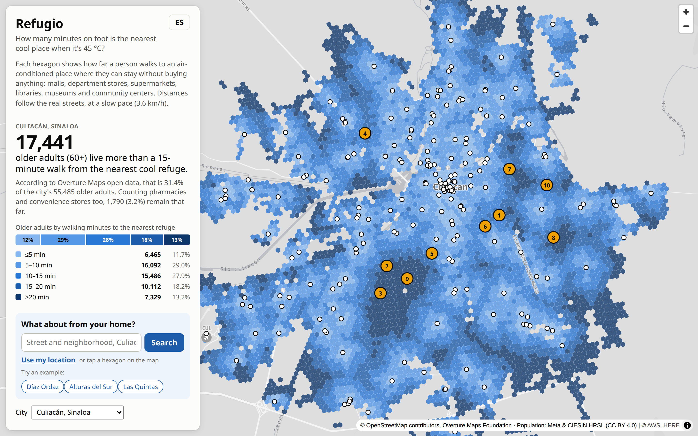
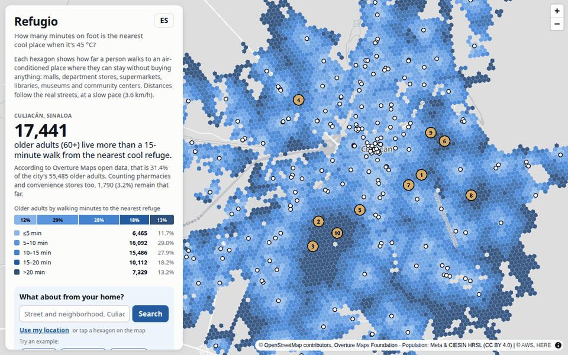
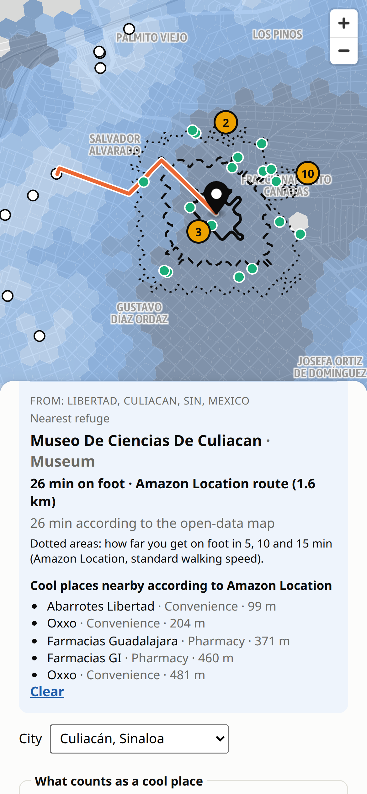
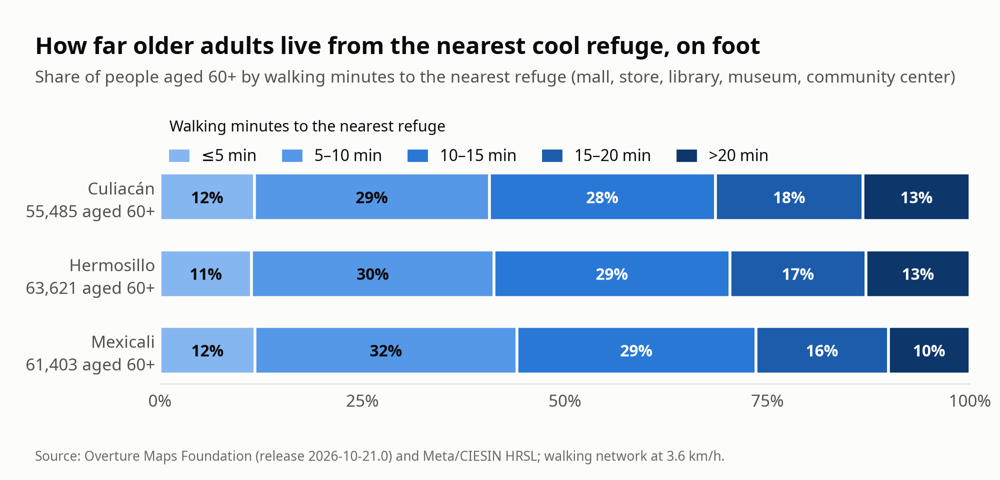
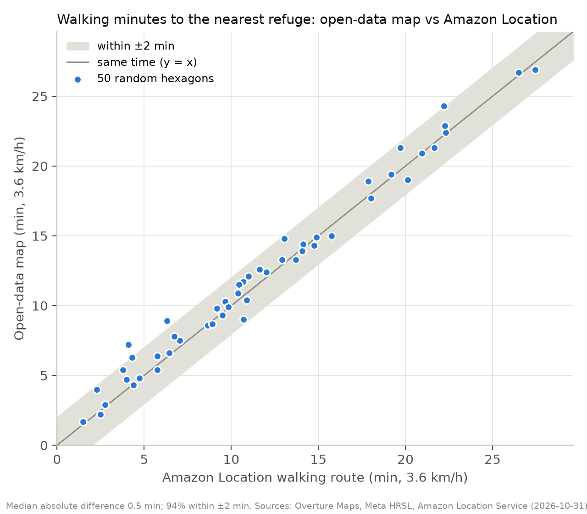
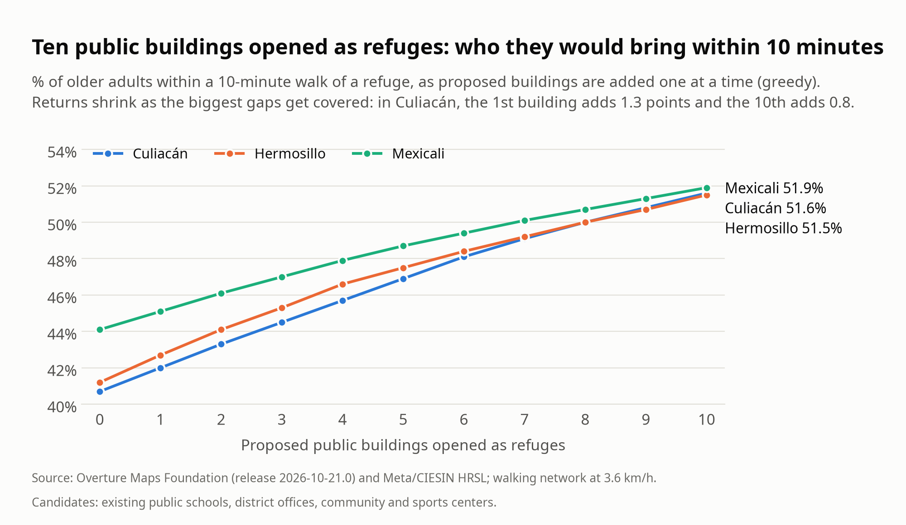
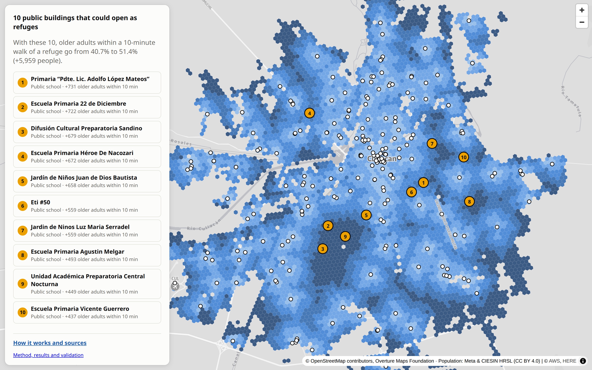

<!--
DRAFT for the AWS Builder Center article. Before publishing:
  1. Replace every TODO(José) with your own words (your story, what you learned, the video link).
  2. Cover image: docs/assets/k4_hero.png. Upload the other images where they appear below,
     with the alt text and the caption written under each one.
  3. Code blocks: paste them as code blocks in the editor.
  4. Tags: check what other entries in the hackathon's Projects tab use (e.g. Amazon Location Service, open data, maps).
  5. After publishing, open it in an incognito window and check every link.
Every number comes from web/data/<city>/stats.json, docs/validation.md or docs/assets/latency.json.
-->

# Refugio: how far do Culiacán's older adults have to walk in 45 °C heat to reach a cool place?

> **Try it in 1 minute**
>
> - **Live map:** https://main.d6r3007drgrwp.amplifyapp.com (Spanish by default; press **EN** for English)
> - Press one of the three example buttons (**Díaz Ordaz**, **Alturas del Sur**, **Las Quintas**), or type any
>   Culiacán address, for example `Colonia Libertad, Culiacán`. You can also tap any hexagon.
> - Switch the city to **Hermosillo** or **Mexicali**, and the switch to "refuges + pharmacies and stores".
> - **Method, results and validation on one page:** https://main.d6r3007drgrwp.amplifyapp.com/about.html
> - **Code (MIT) and data (ODbL):** https://github.com/Josegas/Refugio-mapa-de-refugios-contra-el-calor
> - **Video (under 3 min):** TODO(José): YouTube link

## 1. The problem

*A fictional example, built from real data.* Carmen is 72 and lives in colonia Libertad, in the southwest of
Culiacán, Mexico. On a July afternoon at 44 °C she wants to sit somewhere with air conditioning without having
to buy anything. According to open data, the nearest place like that is the city's science museum: 1.6 km away,
a **26-minute walk** at an older person's pace. Amazon Location's walking route gives the same 26 minutes.

Her neighborhood is not an exception:

- Sinaloa ranked first in Mexico for heat-related illness cases in epidemiological week 32 of 2026 (20 cases,
  Mexico's Health Ministry) ([source](https://www.yucatan.com.mx/merida/2026/08/20/otro-caso-de-golpe-de-calor-en-yucatan-en-mexico-hay-4-nuevas-defunciones.html)).
- Mexico recorded at least 121 deaths from extreme temperatures between March and August 2026
  ([source](https://www.unotv.com/clima/muertes-calor-mexico-2026/)).
- Culiacán reaches 45 °C ([source](https://www.luznoticias.mx/2026-07-10/sinaloa/como-sobrevivir-a-un-golpe-de-calor-en-culiacan-la-capital-de-sinaloa-registra-hasta-45-c-/296549)),
  and about 31% of its city buses had no air conditioning in 2024
  ([source](https://www.luznoticias.mx/2024-07-13/sinaloa/culiacan-estas-son-las-rutas-donde-hay-menos-camiones-con-aire-acondicionado/211490)).

TODO(José): 2-3 sentences of your own story. You live in Culiacán: what is that heat like, and who did you
think of when you built this?

**Refugio** answers two questions. For a resident or a family member: *where can I cool down, and how far is
it on foot?* For the city (Civil Protection, the planning institute): *where are cool refuges missing, and which
public buildings should open during a heat wave?*

## 2. What it does


*The planning layer: darker hexagons are farther, on foot, from an air-conditioned place where you can stay.
The dark patches in the south and southwest are where refuges are missing. Data: Overture Maps, Meta/CIESIN HRSL.*

- **A walking-time map for the whole city.** Each H3 hexagon (about 1.5 ha) shows the minutes on foot, along
  the real streets at 3.6 km/h, to the nearest *refuge*: a mall, department store, large supermarket, library,
  museum, cultural or community center.
- **The headline.** In Culiacán, **17,441 older adults (60+), 31.4% of the 55,485 who live in the city, are more
  than a 15-minute walk from the nearest refuge.** Counting pharmacies and convenience stores, where you can step
  in for a moment and buy water, 1,790 (3.2%) remain that far.
  The counts come from Meta's HRSL, which has about 30% fewer people aged 60+ than Mexico's 2020 census,
  so the real number is probably higher (about 24,700 with the census share; see Evidence).
- **Where refuges are missing.** The areas with the most older adults more than 15 minutes away, ranked. The
  first, Díaz Ordaz / Libertad, has 6,006 older adults with a median walk of 21 minutes.
- **Which buildings could open as refuges.** Ten existing public buildings (all public schools in Culiacán) that
  would take the share of older adults within a 10-minute walk from **40.7% to 51.4%** (+5,959 people).
- **From your own home.** Type an address, tap the map or use your location. Amazon Location Service draws the
  area you can reach on foot in 5, 10 and 15 minutes, the walking route to the nearest refuge, and the cool
  places it knows nearby.
- **Three cities, two languages, any screen.** Culiacán, Hermosillo and Mexicali, in Spanish and English, on a
  desktop or a phone.


*A personal search with Amazon Location: the 15-minute walking area (dotted) doesn't reach the nearest refuge.*


*The same search on a phone: nearest refuge, Amazon Location's walking time and the open-data estimate side by side.*

## 3. The data

Both datasets come from the [Registry of Open Data on AWS](https://registry.opendata.aws/), in Amazon S3.

| Dataset                                                                                 | What I use                                                                     | Version              | License                                           |
| --------------------------------------------------------------------------------------- | ------------------------------------------------------------------------------ | -------------------- | ------------------------------------------------- |
| [Overture Maps](https://registry.opendata.aws/overture/) places                          | Places with category, brand and confidence: 28,002 in Culiacán's bounding box | Release 2026-10-21.0 | CDLA Permissive 2.0, Apache 2.0, CC0 (by source)  |
| Overture Maps transportation                                                            | 49,024 road segments with their connectors: the walking network                | Release 2026-10-21.0 | ODbL, © OpenStreetMap contributors               |
| Overture Maps divisions                                                                 | The city limit (Culiacán) and neighborhood names                              | Release 2026-10-21.0 | ODbL, © OpenStreetMap contributors               |
| [Meta HRSL](https://registry.opendata.aws/dataforgood-fb-hrsl/), general and elderly 60+ | Population, total and aged 60+, at about 30 m                                  | Latest               | CC BY 4.0, Meta and CIESIN – Columbia University |

Only each city's bounding box is read, with HTTP range requests on GeoParquet and Cloud-Optimized GeoTIFF files,
so Culiacán downloads in 34 seconds instead of pulling global files. No AWS account is needed for this step.

## 4. How it's put on the map


*Refugio's architecture: a pipeline that runs once per city, and a static site that calls Amazon Location live.
One region, us-west-2. No servers to run.*

**Build time: the pipeline.** A Python pipeline turns the open data into small static files:

1. **Read from S3.** DuckDB queries Overture's GeoParquet by bounding box; rasterio reads only the needed window
   of the HRSL rasters.
2. **Classify places.** Categories and names (including chain brands) decide what is a refuge (211 in Culiacán), a quick stop (366
   pharmacies and convenience stores) or a candidate public building (196). A documented list removes clear
   mistakes.
3. **Walking network.** 49,024 road segments become 39,069 intersections and 57,276 street edges (4,567 km).
4. **Population on H3.** 90,767 populated pixels are summed into 6,932 hexagons.
5. **Walking minutes.** One multi-source Dijkstra run gives every hexagon its walk to the nearest refuge door.
6. **Proposals.** A greedy maximum-coverage algorithm picks the public buildings that bring the most older
   adults within 10 minutes.


*What goes in and out of each stage for Culiacán: 34 s to download, 2.1 s to compute on a laptop.*

The query that reads Overture places straight from S3 (`pipeline/fetch.py`):

```python
con.sql(f"""COPY (
    SELECT id, names.primary AS name, taxonomy.primary AS cat, basic_category,
           brand.names.primary AS brand, confidence, operating_status,
           addresses[1].freeform AS addr, ST_X(geometry) AS lon, ST_Y(geometry) AS lat
    FROM read_parquet('{OVERTURE}/theme=places/type=place/*', hive_partitioning=1)
    WHERE {bf}) TO '{out}/places.parquet'""")
```

**Live: the app.** The site is static (HTML, vanilla JavaScript, MapLibre GL JS and h3-js) on AWS Amplify
Hosting. The hexagons are built in the browser from a 326 KB file. The figures are written into the HTML by
the pipeline, so the page reads without JavaScript. When someone searches, the browser calls Amazon Location
directly with an API key that only works from this site:


*One search, measured on the live site: 486 ms from pressing Search to the answer (median of 5 searches).*

```javascript
const [iso, route, nearby] = await Promise.allSettled([
  locationApi(ROUTES_API, "isolines", { Origin: lngLat, Thresholds: { Time: [300, 600, 900] },
    TravelMode: "Pedestrian", IsolineGeometryFormat: "Simple" }, "CalculateIsolines"),
  locationApi(ROUTES_API, "routes", { Origin: lngLat, Destination: destination, TravelMode: "Pedestrian",
    TravelModeOptions: { Pedestrian: { Speed: 3.6 } }, LegGeometryFormat: "Simple" }, "CalculateRoutes"),
  locationApi(PLACES_API, "search-nearby", { QueryPosition: lngLat, QueryRadius: 1500, MaxResults: 20,
    Filter: { IncludeCategories: NEARBY_CATEGORIES }, Language: state.lang }, "SearchNearby"),
]);
```

| Service                                  | Used for                              | Why this one                                                                             |
| ---------------------------------------- | ------------------------------------- | ---------------------------------------------------------------------------------------- |
| Registry of Open Data on AWS (Amazon S3) | Overture Maps and Meta HRSL           | Open, global data in cloud-native formats: the same code works for any Mexican city.     |
| Amazon Location Service: Maps            | Base map                              | A vector style with an API key; no tile server to run.                                   |
| Amazon Location Service: Places          | Geocode and SearchNearby              | Current commercial places that complement Overture. Used as `SingleUse`: never stored. |
| Amazon Location Service: Routes          | CalculateIsolines and CalculateRoutes | Pedestrian routing from the exact address, which can't be precomputed for every home.    |
| AWS Amplify Hosting                      | The static site, CDN and HTTPS        | Deployed by GitHub Actions with OIDC: no AWS keys stored anywhere.                       |
| AWS Budgets                              | Cost alerts                           | Warns by email if the public API key is abused.                                          |

Everything on AWS (the API keys, the Amplify app, the budget and the deploy role) is defined in Terraform. Every
push to `main` runs the tests, a secret scan and Terraform checks before it deploys, and a workflow checks
the live site every 3 hours.

## 5. Key decisions, and what they cost

**Design principle: open data finds the gaps; Amazon Location guides the person.** The citywide layer has to
be reproducible and free to recompute, so it comes only from open data. The personal layer has to be exact
from someone's door, so it uses Amazon Location live.

| Decision                                           | Why                                                                                                                                                                                 | What I gave up                                                                                                                                         |
| -------------------------------------------------- | ----------------------------------------------------------------------------------------------------------------------------------------------------------------------------------- | ------------------------------------------------------------------------------------------------------------------------------------------------------ |
| Walk along the street network, not a radius        | In Culiacán the walk along the streets is a median 1.24 times the straight line (5th-95th percentile: 1.09 to 1.71). A radius would hide the people a river or a highway cuts off. | Building and checking a graph of 57,276 edges instead of drawing circles.                                                                              |
| H3 hexagons at resolution 10                       | Equal-size cells, about a block each, that the browser rebuilds from their IDs; people are counted per cell, never per home.                                                        | Hexagon edges don't follow streets or blocks.                                                                                                          |
| Greedy coverage over *existing public* buildings | Simple to explain to a city official and it shows the diminishing returns. Opening an existing school is cheaper than building.                                                     | It isn't the global optimum, and "public" is inferred from the building's name.                                                                        |
| `SingleUse` for Amazon Location results          | The planning layer stays 100% open and reproducible; Amazon results are drawn and discarded.                                                                                        | Every search costs requests; nothing is cached.                                                                                                        |
| A static site, no backend                          | Nothing to patch or scale; Amplify serves it from a CDN.                                                                                                                            | The API key is visible in the browser, so it is limited to 5 actions and this domain, expires on 2027-01-31, and the app allows 30 searches per visit. |

The core of the greedy step (`pipeline/build.py`): pick the building that covers the most older adults who
aren't covered yet, mark them as covered, repeat.

```python
for rank in range(1, N_PROPOSALS + 1):
    ci = max(covers, key=lambda k: weight[covers[k]].sum())
    gain = float(weight[covers[ci]].sum())
    if gain < 1:
        break
    proposals.append({**{k: candidates[ci][k] for k in ("name", "type", "lon", "lat")},
                      "rank": rank, "new_pop60": round(gain)})
    weight[covers[ci]] = 0          # these older adults are now covered
    del covers[ci]
```

## 6. Evidence


*About three in ten older adults live more than 15 minutes from a refuge in all three cities. Data: Overture Maps, Meta/CIESIN HRSL.*

**Is the open-data map right?** I compared it with Amazon Location. For 50 random hexagons where older adults
live in Culiacán, `CalculateRoutes` (Pedestrian, 3.6 km/h) walked from each hexagon to the refuge the map says is
nearest:


*Open-data minutes versus Amazon Location minutes for 50 random hexagons: median difference 0.5 min, 94% within ±2 min.*

| Evidence                                                | Result                                                                                                                                                                                               | Source                       |
| ------------------------------------------------------- | ---------------------------------------------------------------------------------------------------------------------------------------------------------------------------------------------------- | ---------------------------- |
| Walking minutes vs Amazon Location routes (50 hexagons) | Median difference 0.5 min; 90th percentile 1.7 min; 94% within ±2 min; 100% within ±5 min; correlation 0.99                                                                                        | `docs/validation.md`       |
| Places Overture is missing                              | In 10% of those hexagons (home to 12% of the sampled older adults), Amazon Location knows a refuge-type place at least 150 m closer, so the share far from a refuge is probably somewhat lower.                                 | `docs/validation.md`       |
| Spot-check of 15 random refuges                         | 10 found by name within 300 m; 8 with a compatible category                                                                                                                                          | `docs/validation.md`       |
| Older adults: HRSL vs INEGI's 2020 census | Census: 10.9% of Culiacán's population is 60+; HRSL: 7.7% (similar in the other two cities). Counts are probably about 40% low; the shares hold if the gap is even | `pipeline/census.py`, `docs/validation.md` |
| Data cleanup                                            | 6 clear false positives removed by hand (a cable company office and a travel agency labeled as malls, among others), with tests                                                                      | `pipeline/build.py`        |
| Pipeline                                                | Culiacán: 34 s to download from S3, 2.1 s to compute; same code for 3 cities                                                                                                                        | `stats.json`               |
| Live search                                             | 486 ms median from Search to the answer                                                                                                                                                              | `docs/assets/latency.json` |
| Tests                                                   | 47 automated tests: classification, band totals, "adding stores never makes access worse", network realism. CI runs them on every push; the network test needs the raw downloads, so it runs locally | `pipeline/tests/`          |


*Ten public buildings would bring about one in ten more older adults within 10 minutes of a refuge. Each one adds less than the first.*

## 7. Challenges and mistakes

- **The Overture schema had changed.** My first query asked for `categories.primary` and failed: in release
  2026-10-21.0 the field is `taxonomy.primary`, as a `DESCRIBE` of the files showed. The same query also got a 403
  because my laptop's AWS credentials were sent to a public bucket; an anonymous DuckDB secret fixed it.
- **Noisy categories.** A bank showed up as a mall, a prison as a government office, cemeteries as community
  places. An exclusion list fixed most of it; a hand review of every refuge name removed 6 more.
- **The first proposals were private schools and churches.** The greedy algorithm only maximizes coverage.
  Restricting candidates to public buildings, recognized by name, made the proposals ones a city could act on.
  Two later proposals looked private (a brand-like name for a combined preschool and primary school, and one
  named after a teaching method popular with private schools). I couldn't confirm they were public, so I dropped them.
- **The population layer undercounts older adults.** HRSL puts 7.7% of Culiacán's population at 60+; INEGI's 2020
  census, 10.9%. I kept HRSL, because it says *where* people live, and report the gap with numbers instead of hiding it.
- **A test caught a distance bug.** The test "adding pharmacies never makes access worse" failed in 28 hexagons:
  the search picked the refuge with the nearest street corner, not the nearest door. A virtual source node fixed it.
- **Hermosillo and Mexicali have no city polygon in Overture**, only whole municipalities, mostly desert. The
  study area became the largest contiguous cluster of H3 cells with at least 300 people/km², the
  "urban cluster" threshold of the EU/OECD/UN Degree of Urbanisation, clipped so Mexicali doesn't route through Calexico.
- **Isolines can't take a walking speed**, so the walking areas use Amazon Location's default pedestrian speed,
  while the route uses 3.6 km/h. The app says so on screen.

## 8. Cost

- **Per search: 6 billable requests** (1 Geocode, 3 isolines, 1 route, 1 SearchNearby). A tap on the map skips Geocode.
- Amazon Location's free tier for the first three months includes 500,000 map tiles, 20,000 Geocode/SearchNearby
  requests and 10,000 routes a month ([pricing](https://aws.amazon.com/location/pricing/)).
- **Guards:** the key only allows the 5 calls the app makes, only from this site, and expires on 2027-01-31; the
  app stops calling after 30 searches per visit; an AWS Budget of $5 a month emails me at the first cent, at 50%
  and when the forecast reaches 100%.
- The pipeline needs no account at all; the static site costs nothing to keep running at this traffic.

## 9. Impact

Across the three cities, **52,542 older adults** live more than a 15-minute walk from a cool refuge
(17,441 in Culiacán, 18,859 in Hermosillo, 16,242 in Mexicali).

- **Residents and families** get a direct answer from their own address, on a phone, with the walking time
  from Amazon Location next to the open-data estimate.
- **Civil Protection or a city planning institute** gets a ranked list of areas and of public buildings to open
  during a heat wave, with how many older adults each one would bring within 10 minutes.


*The 10 proposed buildings in Culiacán: from 40.7% to 51.4% of older adults within 10 minutes of a refuge.*

The pipeline is the same for any Mexican city: about 40 seconds of download and 2 seconds of compute. The
natural next step is an official refuge network checked with the city: confirmed air conditioning, opening hours
and permission to stay.

## 10. Limitations and next steps

- Air conditioning and free entry are assumed from the type of place, not checked one by one.
- Overture doesn't list every place (it has few convenience stores), so real access is probably better than shown.
- HRSL counts about 30% fewer people aged 60+ than the 2020 census, so the counts of older adults are probably low.
- Shade, sidewalks, safety and opening hours are not modeled: malls close at night, and the heat peaks from
  2 to 5 pm. Amazon Location's `OpeningHours` could filter refuges open at that time.
- The map doesn't know who has a car. Next: cross it with Mexico's urban marginalization index.
- The walking speed (3.6 km/h) is an assumption.
- Next: a heat-wave alert that opens the map with the weather forecast, and community checks ("did this place let
  you in to cool down?").

## 11. What I learned

TODO(José): write this in first person, in your own words. Some ideas from the journal: reading cloud-native
open data by bounding box instead of downloading it; that a radius lies and a street network doesn't; letting
a test find a bug you didn't know you had; deploying with OIDC instead of keys; and how much the numbers improved
once you checked them against Amazon Location.

## 12. How I used AI

Planning, research and the pipeline prototype with Claude; implementation with Claude Code. I reviewed and can
explain every piece.

---

**Live map:** https://main.d6r3007drgrwp.amplifyapp.com · **About:** https://main.d6r3007drgrwp.amplifyapp.com/about.html ·
**Code:** https://github.com/Josegas/Refugio-mapa-de-refugios-contra-el-calor · **Video:** TODO(José)

*Data: Overture Maps Foundation (© OpenStreetMap contributors; Meta, Microsoft, Foursquare, AllThePlaces) and
Meta and CIESIN – Columbia University, High Resolution Settlement Layer (CC BY 4.0). Base map and live search:
Amazon Location Service.*
